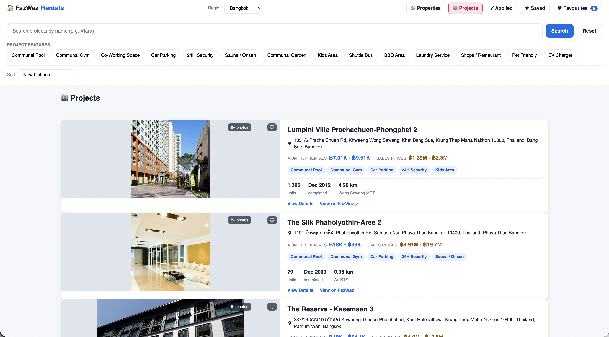
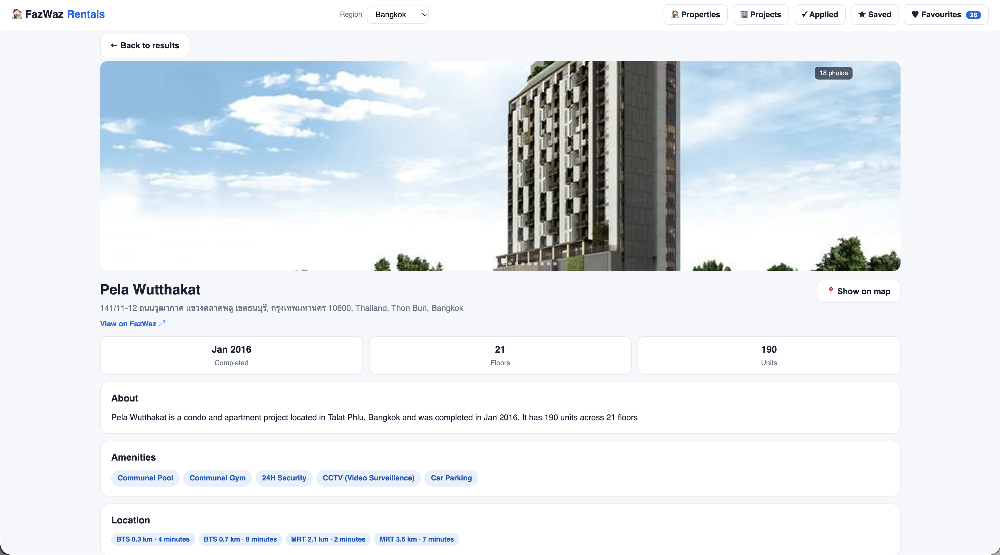
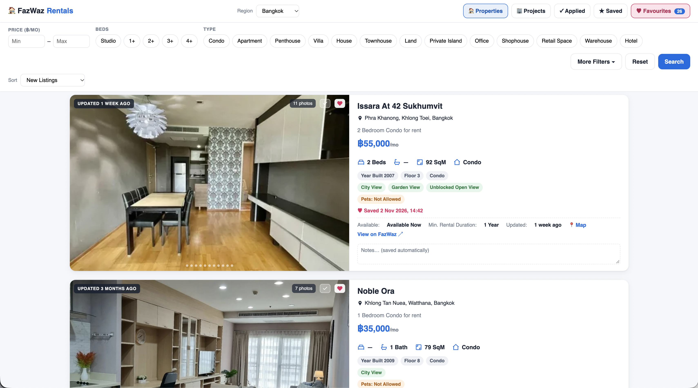
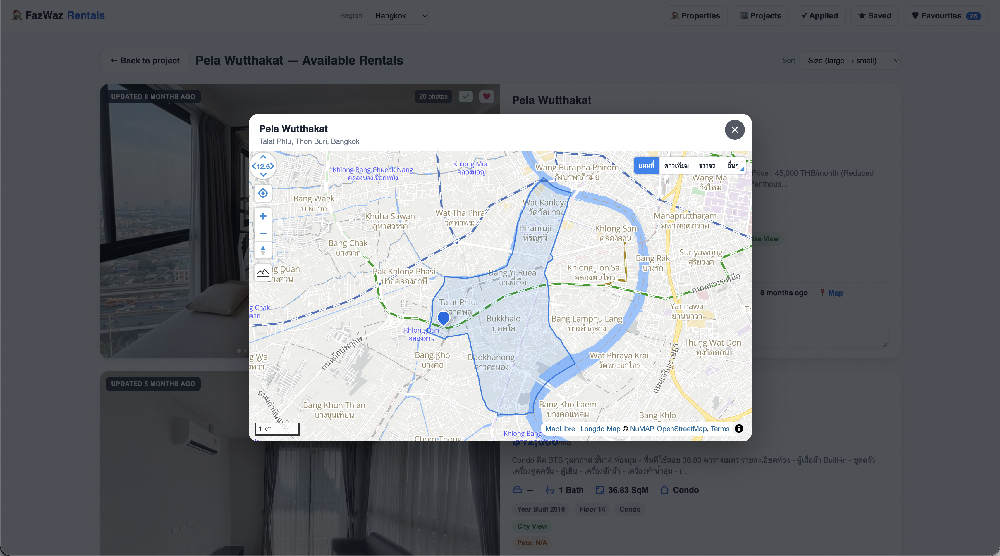

# FazWaz Rentals

A self-hosted rental property search app for Thailand, built on top of
[fazwaz.com](https://www.fazwaz.com). Searches are run live against FazWaz
(no official public API — the app fetches the server-rendered search pages and
parses them), with results cached on disk. All personal features — favourites,
per-listing notes, saved searches, applied marks — are stored locally in plain
JSON files that never leave your machine.

## Features

- Live rental search with the full FazWaz filter set (price, beds, type, pets,
  furniture, amenities, views, transit proximity, …)
- OR-combinations within a filter group (double-tap a chip to merge)
- One-click favourites with saved snapshots (view them offline after a unit is
  delisted), server-side filtering of your saved list
- Private notes per listing, saved searches with a default search, applied marks
- Building/project directory: project pages with available rental units
- Map view (Longdo Maps, with Leaflet/OpenStreetMap fallback), district
  boundary outlines, nearby transport POIs
- Installable PWA, mobile bottom-sheet UI

## Requirements

- Node.js 18+
- **curl** on the PATH — required. FazWaz sits behind Cloudflare, which blocks
  Node's TLS fingerprint; the app shells out to `curl` with a browser user-agent
  instead. Without curl, all upstream fetches fail.
- A **Longdo Maps API key** (optional but recommended) — see below.

## Setup

```bash
npm install
npm start          # listens on 0.0.0.0:3100 (override with PORT=...)
# open http://localhost:3100
```

Your data lives in `data/` (created on first start): `favourites.json`,
`notes.json`, `saved-searches.json`, `applied.json`,
`project-favourites.json`, plus a disk cache in `data/cache/`. Back up that
folder to move or keep your data; delete the cache freely to reclaim space.
`data/filters.json` is the shipped filter schema, not user data.

## Longdo Maps key

The map modal uses [Longdo Maps](https://map.longdo.com/) by default and falls
back to Leaflet + OpenStreetMap if no key is present. A Longdo key is free for
personal use but **must be requested from Longdo** (their console ties the key
to your referer/hostname).

To configure it, either:

- set an environment variable: `LONGDO_API_KEY=yourkey npm start`, or
- put `LONGDO_API_KEY=yourkey` in a file named `longdo.env` at
  `/workspace/secrets/longdo.env` (the path this app shares with other local
  apps in this workspace).

Note: the key is intentionally served to the app's own frontend via
`GET /api/longdo-key` (the Longdo JS SDK needs it client-side). That is fine on
a private LAN; if you expose this app publicly, proxy it behind auth or accept
that map visitors will see the key.

## How it works

- Upstream fetching is done via `curl` (see Requirements) with short retry on
  transient failures; responses are cached on disk (search 2 h, details 12 h).
- Search pages are server-rendered HTML: the app splits on card markers, parses
  unit ids, prices, photos (signed CDN URLs harvested from the HTML) and the
  total from `"actuallyTotal":N`.
- Paging past the last result page 404s upstream — the app converts that into a
  normal empty page.
- No rate limiting was observed upstream, but this is a personal-use tool:
  keep it that way and don't hammer FazWaz.

## Disclaimer

This project is not affiliated with FazWaz. It scrapes a website that offers no
public API, so anything upstream can change and break parsing. Intended for
personal, non-commercial use.

## Screenshots

### Project search



### Project detail



### Favourite properties



### Longdo map integration


